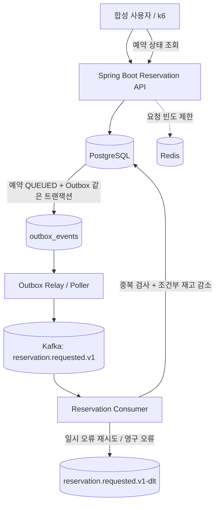
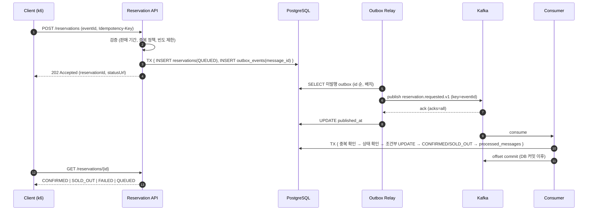
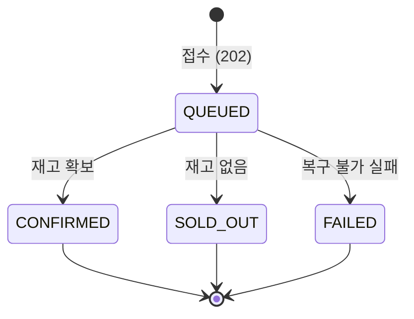

<div align="center">

# 🎫 TicketFlow Kafka

**대규모 트래픽 티켓 예약 서버**<br>
Kafka 이벤트 기반 비동기 예약 · 동시성 제어 · 장애 대응 · 성능 분석

<sub>A Kafka-powered ticket reservation backend with transactional outbox, idempotent consumers, and concurrency testing.</sub>

<br>


[📋 PRD](prd.md) · [🏗️ 아키텍처](docs/architecture.md) · [🗄️ DB 설계](docs/database.md) · [📨 이벤트 계약](docs/event-contract.md) · [📊 벤치마크](docs/benchmark-report.md)

</div>

<br>

> [!NOTE]
> 현재 **기획·설계 단계**입니다 (2026-11-20 기준). 문서와 폴더 구조만 있으며, 코드는 1주차(2026-11-23)부터 작성합니다.

<br>

## 📖 프로젝트 소개

인기 공연의 티켓이 소량 남은 상황에서 예약 요청이 한꺼번에 몰리는 문제를 다룹니다.
API는 요청을 **먼저 접수**하고, 확정은 Kafka를 통해 **비동기로 처리**합니다. 이 과정에서 중복 예약, 초과 판매, 메시지 중복 처리, Consumer 장애가 생겨도 결과가 정확한지 검증합니다.

<div align="center">

| 🎟️ 잔여 티켓 | 👥 동시 예약 시도 | 🎯 목표 |
| :---: | :---: | :---: |
| **100장** | **1,000명** | 초과 판매 **0** · 중복 확정 **0** |

</div>

### 해결할 문제

| 문제 | 원인 | 해결 수단 |
| --- | --- | --- |
| 초과 판매 | 동시 요청이 같은 재고를 동시에 읽고 감소 | DB 조건부 `UPDATE` + `CHECK` 제약 |
| 중복 예약 | 클라이언트 재시도, 같은 요청 반복 전송 | `Idempotency-Key` + `UNIQUE` 제약 |
| DB·메시지 불일치 | DB 커밋 후 Kafka 발행 전 장애 | Transactional Outbox |
| 중복 처리 | at-least-once 전달, Outbox 재발행 | `processed_messages` + 상태 조건부 갱신 |
| 처리 유실·정체 | Consumer 장애, 처리 불가 메시지 | 재시도 정책 + Dead Letter Topic |

<br>

## 💡 핵심 설계 원칙

> [!IMPORTANT]
> **Kafka를 도입했다고 초과 판매가 자동으로 막히지는 않습니다.**
> 정확성의 최종 근거는 PostgreSQL의 원자적 조건부 갱신과 트랜잭션입니다.

| 구성 요소 | 맡는 일 | 맡지 않는 일 |
| --- | --- | --- |
| **PostgreSQL** | 재고·예약 정확성의 최종 근거 (트랜잭션, 제약 조건) | — |
| **Kafka** | 대량 요청의 비동기 완충, 이벤트 전달, Consumer 확장·장애 복구 | 정확성 보장 |
| **Redis** | 사용자별 요청 빈도 제한 | 재고·예약의 원본 데이터 |

- 메시지 전달은 항상 **at-least-once**로 가정하고, 모든 Consumer 처리를 멱등하게 만듭니다.
- **`202 Accepted`는 좌석 확보가 아니라 접수 완료**를 뜻합니다.
- 엄격한 선착순(공정 대기열)은 범위 밖입니다. HTTP 도착 순서와 Kafka 처리 순서는 다를 수 있습니다.

<br>

## 🏗️ 아키텍처



### 예약 처리 흐름



### 예약 상태



`SOLD_OUT`은 실패가 아니라 정상적인 업무 결과이므로 재시도하지 않습니다.

<br>

## 🛠️ 기술 스택

| 영역 | 기술 | 용도 |
| --- | --- | --- |
| **Language** |  | 백엔드 언어 |
| **Framework** |    | 트랜잭션, 비즈니스 로직, 이벤트 생산·소비 |
| **Messaging** |  | 비동기 완충, 재시도, DLT |
| **Database** |   | 원자적 재고 갱신, 스키마 마이그레이션 |
| **Cache** |  | 요청 빈도 제한 |
| **Infra** |   | 로컬 단일 실행 환경 |
| **Test** |   | 실제 Kafka·PostgreSQL 통합 테스트 |
| **Performance** |   | 부하 생성, p95·오류율·lag 측정 |
| **Monitoring** <sub>(후순위)</sub> |   | 지표 수집·시각화 |
| **Docs · CI** |   | API 문서, 자동 테스트 |

<br>

## ✨ 주요 기능

<table>
<tr>
<td valign="top" width="50%">

**P0 — 핵심**

- [ ] 공연 등록·조회
- [ ] 예약 접수 API (`202` + `reservationId`)
- [ ] 멱등성 키 기반 중복 요청 방어
- [ ] Transactional Outbox 발행
- [ ] Kafka Consumer 예약 처리
- [ ] 원자적 재고 감소
- [ ] 예약 상태 조회 (polling)

</td>
<td valign="top" width="50%">

**P1 — 안정성·운영**

- [ ] Consumer 장애 복구 (재시도·DLT)
- [ ] Redis 요청 빈도 제한 (`429`)
- [ ] 운영 지표 (확정 지연, 오류율, lag)
- [ ] 동기 처리 비교 모드 (벤치마크용)

**P2 — 후순위**

- [ ] DLT 조회 API
- [ ] Prometheus + Grafana 대시보드

</td>
</tr>
</table>

<br>

## 🛡️ 정확성 보장 전략

한 가지 장치에 기대지 않고, 위협마다 방어를 겹칩니다.

| 위협 | 방어 위치 | 구현 |
| --- | --- | --- |
| 초과 판매 | DB | 조건부 `UPDATE` 한 문장 + `CHECK (remaining_tickets BETWEEN 0 AND total_tickets)` |
| 같은 요청 반복 | API · DB | `Idempotency-Key` + `UNIQUE(user_id, idempotency_key)` |
| 같은 공연 중복 예약 | DB | `UNIQUE(event_id, user_id)` |
| 이벤트 유실 | DB | 예약과 Outbox를 같은 트랜잭션에 기록 |
| 메시지 중복 소비 | Consumer · DB | `processed_messages` PK + `WHERE status = 'QUEUED'` 조건부 상태 변경 |
| 처리 불가 메시지 | Kafka | 일시 오류는 재시도, 영구 오류는 DLT로 격리 |
| 과도한 요청 | Redis | 사용자별 빈도 제한 |

```sql
-- 재고 감소는 이 한 문장으로만 한다 (읽고 계산한 뒤 쓰는 방식 금지)
UPDATE events
   SET remaining_tickets = remaining_tickets - 1
 WHERE id = :eventId
   AND remaining_tickets > 0
   AND sales_start_at <= CURRENT_TIMESTAMP
   AND sales_end_at   >  CURRENT_TIMESTAMP;
-- 1행 → CONFIRMED / 0행 → SOLD_OUT 또는 판매 기간 외
```

### 보장하는 것과 보장하지 않는 것

| ✅ 보장 | ❌ 보장하지 않음 |
| --- | --- |
| 확정 수 ≤ 총 수량, 잔여 재고 ≥ 0 | 엄격한 HTTP 도착 순서대로의 선착순 |
| 같은 예약 요청의 중복 확정 0 | `202` 응답 시점의 좌석 확보 |
| API 성공 후 이벤트 유실 없음 | 메시지의 정확히 한 번 전달 (업무 결과만 1회 적용) |
| Consumer 재시작 후 처리 재개 | 단일 노드 Kafka의 고가용성 |
| 처리 불가 메시지의 DLT 격리와 이력 | 로컬 측정 수치의 운영 환경 재현 |

<br>

## 🧪 검증 시나리오

| ID | 시나리오 | 합격 기준 |
| --- | --- | --- |
| `LOAD-01` | 티켓 100장에 고유 사용자 1,000명 집중 예약 | `CONFIRMED = 100`, 초과 판매 0 |
| `CON-01` | 같은 사용자·공연·멱등성 키로 10회 요청 | 예약 1건만 생성 |
| `CON-02` | 재고 1장에 동시 처리 | 확정 1건, 음수 재고 0 |
| `MSG-01` | 같은 `messageId` 2회 소비 | 재고 1회만 감소 |
| `MSG-02` | 처리 전 / 중 / 커밋 직후 Consumer 강제 종료 | 재시작 후 유실·중복 확정 없음 |
| `MSG-03` | Kafka 발행 후 `published_at` 갱신 전 Relay 중단 | 중복 메시지에도 정상 결과 |
| `MSG-04` | 재시도할 수 없는 스키마 오류 메시지 | DLT 이동, 감사 이력 유지 |
| `PERF-01` | 50 → 100 → 300 → 500 RPS 단계적 증가 | p95·오류율·lag 측정 및 분석 |
| `SEC-01` | 같은 사용자의 반복 예약 요청 | 빈도 제한·중복 억제 동작 |

**측정 지표:** 접수 p95 · 확정 p95 · RPS와 오류율(5xx / 429 / 409 분리) · 재고 불변식 · 중복 확정 건수 · Consumer lag · Outbox 미발행 건수

> [!TIP]
> '가상 사용자 1,000명'과 '초당 1,000요청'은 다른 조건입니다. 모든 측정 결과에는 VU 수, 요청 도착률, 실행 시간, PC 사양을 함께 기록합니다.

<br>

## 📁 프로젝트 구조

```text
ticketflow-kafka
├── prd.md                         # 제품 요구사항 문서
├── README.md
├── .env.example                   # 환경 변수 예시 (.env는 커밋 금지)
│
├── backend/                       # Spring Boot 단일 코드베이스
│   └── src
│       ├── main
│       │   ├── java/com/ticketflow
│       │   │   ├── event/         # 공연 등록·조회
│       │   │   ├── reservation/   # 예약 접수·조회, 상태 전이
│       │   │   ├── idempotency/   # 멱등성 키 검증
│       │   │   ├── outbox/        # Outbox 엔티티, Relay
│       │   │   ├── messaging/     # Kafka Producer·Consumer, 재시도·DLT
│       │   │   ├── monitoring/    # 관리자 지표 API
│       │   │   └── global/        # 공통 설정, 예외, 응답 형식
│       │   └── resources
│       │       └── db/migration/  # Flyway 마이그레이션
│       └── test/java/com/ticketflow
│           ├── reservation/       # CON-01, SEC-01
│           ├── messaging/         # CON-02, MSG-01, MSG-04
│           ├── outbox/            # Outbox 기록·발행
│           ├── event/
│           └── support/           # Testcontainers 공통 설정
│
├── infrastructure/
│   ├── compose.yml                # PostgreSQL · Kafka(KRaft) · Redis
│   └── monitoring/                # Prometheus · Grafana (후순위)
│
├── load-tests/                    # k6 부하 테스트
│   ├── reservation-spike.js       # LOAD-01
│   └── reservation-ramp.js        # PERF-01
│
├── experiments/                   # 장애 재현 실험 기록
│   ├── duplicate-event.md         # MSG-01
│   ├── consumer-crash.md          # MSG-02
│   └── outbox-republish.md        # MSG-03
│
├── docs/
│   ├── architecture.md
│   ├── database.md
│   ├── event-contract.md
│   ├── api-spec.md
│   ├── benchmark-report.md        # 동기 vs 비동기 비교
│   └── adr/                       # 아키텍처 결정 기록
│
└── .github/workflows/             # CI
```

API, Outbox Relay, Consumer는 **하나의 Spring Boot 코드베이스**에서 패키지로 나눕니다. 확장이 필요하면 `api` / `worker` 프로필로 같은 코드를 별도 프로세스로 실행합니다.

<br>

## 🗓️ 로드맵

| 주차 | 기간 | 목표 | 마일스톤 | 상태 |
| :---: | :---: | --- | --- | :---: |
| 0 | ~ 11/20 | 기획·설계 | PRD, 폴더 구조 | ✅ |
| 1 | 11/23 ~ 11/29 | Spring Boot, PostgreSQL·Kafka Compose, 공연 API | 헬스 체크, DB 연결, 토픽 송수신 | ⏳ |
| 2 | 11/30 ~ 12/06 | 예약 테이블, 접수 API, 멱등성 키 | `202` + `QUEUED` | ⏳ |
| 3 | 12/07 ~ 12/13 | Outbox 트랜잭션, Relay, Kafka Consumer | 접수 → 이벤트 → 예약 완료 | ⏳ |
| 4 | 12/14 ~ 12/20 | 원자적 재고 감소, 중복 소비 방지 | 100장 초과 확정 없음 | ⏳ |
| 5 | 12/21 ~ 12/27 | k6 1,000명 시뮬레이션, 병목 분석 | 재고 불변식 + 성능 보고 | ⏳ |
| 6 | 12/28 ~ 01/03 | Consumer 중단·재시작, 중복 발행, DLT | 장애 복구 테스트 | ⏳ |
| 7 | 01/04 ~ 01/10 | Redis 빈도 제한, 지표·모니터링 | 운영 관측 지표 | ⏳ |
| 8 | 01/11 ~ 01/17 | 통합 테스트, CI, 시연 영상 | 재현 가능한 포트폴리오 | ⏳ |

<br>

## 🚀 시작하기

> [!NOTE]
> 실행 방법은 1주차 작업 후 채웁니다.

**사전 요구사항**

| 도구 | 버전 |
| --- | --- |
| Java | 21 |
| Docker Desktop | WSL2 백엔드 |
| k6 | 부하 테스트 시 |

```powershell
# 환경 점검
java -version
docker compose version

# 환경 변수 준비
Copy-Item .env.example .env
```

<br>

## 📚 문서

| 문서 | 내용 |
| --- | --- |
| [prd.md](prd.md) | 목표, 기능·비기능 요구사항, 검증 계획, 미결 사항 |
| [docs/architecture.md](docs/architecture.md) | 구현된 아키텍처와 장애 시나리오별 동작 |
| [docs/database.md](docs/database.md) | 스키마, 제약 조건, 재고 감소 쿼리 |
| [docs/event-contract.md](docs/event-contract.md) | Kafka 토픽·메시지 스키마 |
| [docs/api-spec.md](docs/api-spec.md) | REST API 명세 |
| [docs/benchmark-report.md](docs/benchmark-report.md) | 동기 vs 비동기 벤치마크 결과 |
| [docs/adr/](docs/adr/) | 아키텍처 결정 기록 (ADR) |
| [experiments/](experiments/) | 장애 재현 실험 기록 |

<br>

## 🚫 범위 밖 (Non-goals)

실제 결제 · 외부 공연 API 연동 · 실서비스 대상 트래픽 · 대규모 MSA · 실제 개인정보 수집 · Kubernetes 운영 · 엄격한 선착순 대기열 · 예약 취소·만료 (2차 버전)

<br>

<div align="center">
<sub>모든 성능 수치는 로컬 단일 PC에서 측정하며, 측정 환경과 조건을 함께 기록합니다.</sub>
</div>
