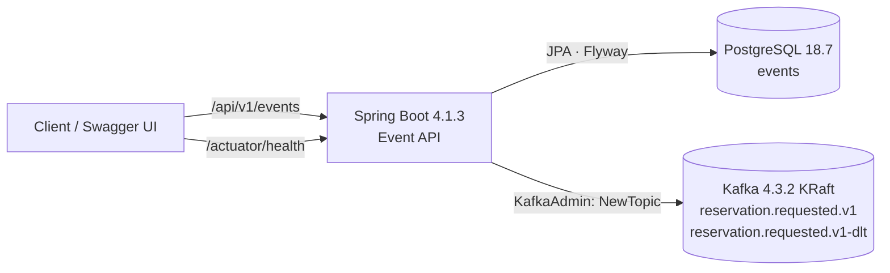
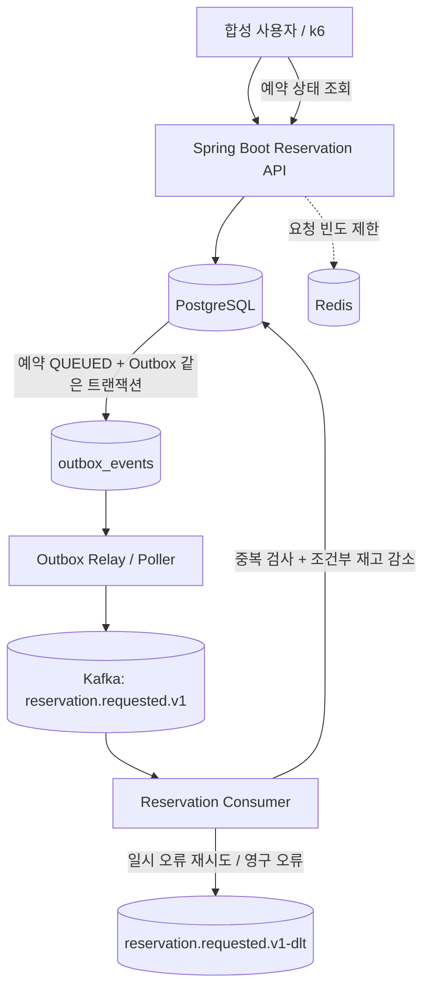

# 아키텍처

> 요구사항 기준: [PRD §8 시스템 아키텍처](../prd.md#8-시스템-아키텍처). 이 문서는 **구현된 결과**를 주차별로 기록합니다.
> 설계 결정의 이유는 [ADR-0001](adr/0001-why-kafka.md)에 있습니다.

## 현재 구현 상태 (1주차 완료)

| 구성 요소 | 상태 | 비고 |
| --- | --- | --- |
| 공연 등록·조회 API | ✅ | 등록은 `local` 프로필 전용 |
| PostgreSQL + Flyway | ✅ | `V1__create_events.sql`, CHECK 제약 3개 |
| Kafka KRaft 단일 노드 | ✅ | 자동 토픽 생성 꺼짐, 토픽은 애플리케이션이 생성 |
| 예약 접수 API | ⏳ 2주차 | |
| Outbox Relay / Consumer | ⏳ 3주차 | |
| 원자적 재고 감소 | ⏳ 4주차 | |
| Redis 빈도 제한 | ⏳ 7주차 | |

## 목표 구성도

## 컴포넌트와 프로세스 배치

- 현재는 **단일 Spring Boot 프로세스**에 모든 컴포넌트가 들어 있다.
- 3주차 이후 필요하면 `api`(접수·조회) / `worker`(Relay·Consumer) 프로필로 같은 코드를 별도 프로세스로 띄운다.

## 로컬 실행 환경

| 서비스 | 이미지 | 호스트 주소 | 비고 |
| --- | --- | --- | --- |
| PostgreSQL | `postgres:18.7-alpine` | `127.0.0.1:15432` | 로컬에 설치된 PostgreSQL(5432)과 충돌을 피하려고 15432 사용 |
| Kafka | `apache/kafka:4.3.2` | `127.0.0.1:9092` | broker + controller 겸용, `auto.create.topics.enable=false` |
| Spring Boot | — | `localhost:8080` | 기본 프로필 `local` |

Testcontainers도 같은 이미지 태그를 쓴다 (`backend/src/test/java/com/ticketflow/support/TestcontainersConfiguration.java`).

## 예약 처리 흐름

<!-- 3주차: PRD §8.3 시퀀스 다이어그램 + 실제 트랜잭션 경계, 오프셋 커밋 시점 -->

## 장애 시나리오별 동작

| 장애 | 동작 | 근거 실험 |
| --- | --- | --- |
| Kafka 일시 중단 | | `experiments/outbox-republish.md` |
| Consumer 강제 종료 | | `experiments/consumer-crash.md` |
| 중복 메시지 | | `experiments/duplicate-event.md` |
| 영구 오류 메시지 | | MSG-04 테스트 |

## 설정값

| 항목 | 값 | 이유 |
| --- | --- | --- |
| 토픽 파티션 수 | 3 | PRD Q6 제안값. 행사 하나의 처리량은 key 특성상 늘지 않음 |
| 토픽 복제 계수 | 1 | 로컬 단일 브로커 |
| Producer `acks` / idempotence | `all` / `true` | 브로커 측 중복 위험 완화 |
| Consumer 자동 커밋 | 꺼짐 | 오프셋 커밋은 Spring 컨테이너가 처리 후 수행 |
| Outbox 폴링 주기 / 배치 크기 | | 3주차 |
| Consumer 동시성 | | 3주차 |
| 재시도 횟수 / 간격 | | 6주차 |
