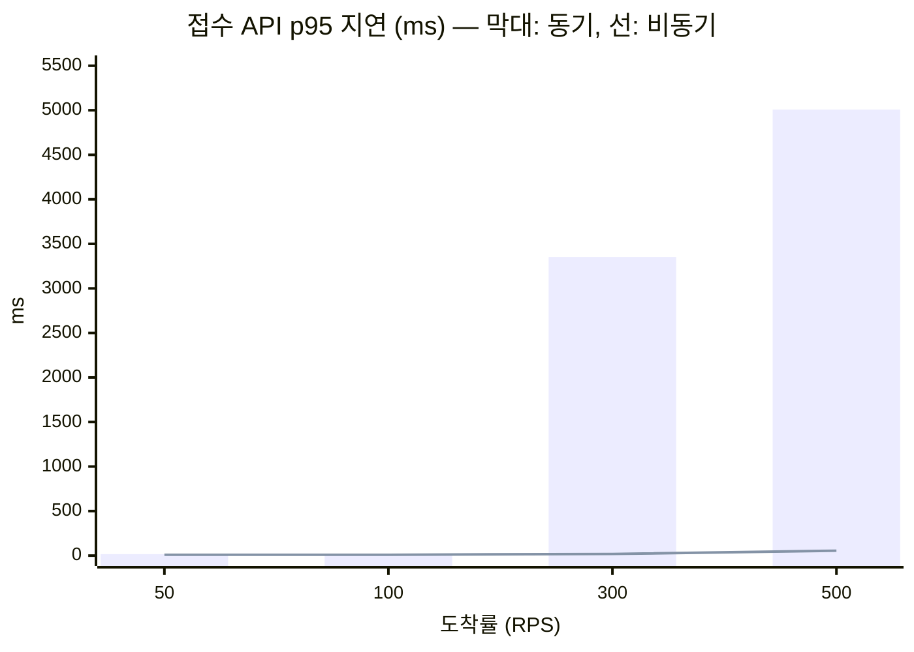
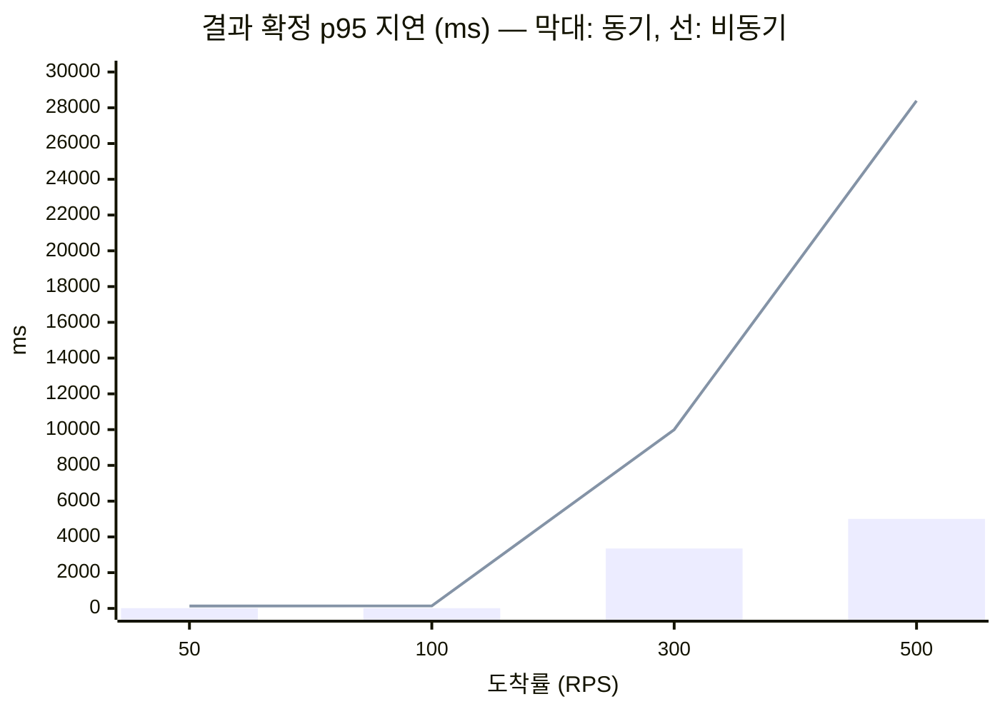
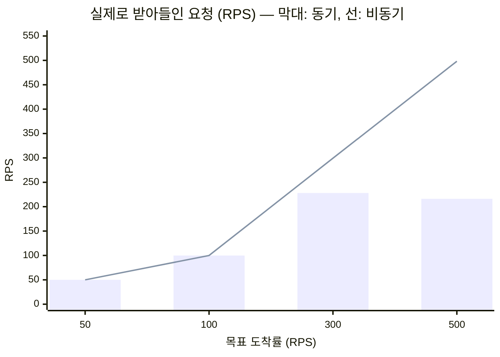

# 벤치마크 보고서

> 요구사항 기준: [PRD §12~13](../prd.md#12-검증-계획), DoD-1, DoD-4, DoD-7.
> 동기 DB 처리와 Kafka 비동기 처리를 **같은 실험 조건**으로 비교합니다. Kafka 방식이 항상 빠르다고 주장하지 않습니다.
> 측정일: 2026-11-20 (5주차). 원본 요약: [`docs/benchmark/2026-11-20/`](benchmark/2026-11-20/)

## 요약

| 질문 | 답 |
| --- | --- |
| 초과 판매가 있었나? | **없음.** 모든 실행에서 불변식 성립. LOAD-01(1,000명/100장)은 두 방식 모두 CONFIRMED 정확히 100 |
| 접수 API는 어느 쪽이 빠른가? | **비동기.** 500 RPS에서 p95 55ms(비동기) vs 5,008ms(동기). 동기는 약 220 RPS에서 포화 |
| 최종 결과는 어느 쪽이 빨리 나오나? | **이 실험에서는 동기.** LOAD-01에서 1,000건 결과가 나오기까지 동기 3.6초, 비동기 7.6초 |
| 공연 하나의 처리량 한계는? | **두 방식 모두 초당 약 210~275건.** 같은 `events` 행을 순서대로 갱신해야 하므로 Kafka를 써도 늘지 않음 |
| 그럼 Kafka가 주는 것은? | 처리 능력을 넘는 요청을 **API 지연·실패 없이 받아 두는 완충**. 대가는 확정 지연(lag)과 운영 복잡도 |

## 실험 환경

| 항목 | 값 |
| --- | --- |
| CPU | Intel Core Ultra 7 258V (8코어 / 8스레드) |
| RAM | 32GB |
| OS | Windows 11 + WSL2, Docker Desktop (8 CPUs, 약 15.4GiB) |
| JVM | Java 21.0.8 (HotSpot), 기본 힙 설정, `gradlew bootRun` |
| 애플리케이션 | Spring Boot 4.1.3, Tomcat 기본(최대 200 스레드), HikariCP 기본(최대 10 커넥션) |
| 이미지 | `postgres:18.7-alpine`, `apache/kafka:4.3.2` (단일 노드 KRaft), `grafana/k6:2.3.0` |
| Kafka 설정 | 파티션 3, Consumer 동시성 3, ack-mode `record`, Relay 폴링 100ms·배치 200 |
| 코드 | 5주차 커밋 (`feat(benchmark): …`) |
| 부하 생성기 위치 | **서버와 같은 PC**, k6를 Docker 컨테이너로 실행 (`host.docker.internal` 경유) |

## 실험 조건

| 항목 | LOAD-01 | PERF-01 |
| --- | --- | --- |
| 스크립트 | `load-tests/reservation-spike.js` | `load-tests/reservation-ramp.js` |
| k6 executor | `per-vu-iterations` (VU 1,000 × 1회) | `constant-arrival-rate` (단계별 20초) |
| 부하 | 고유 사용자 1,000명이 동시에 1회 | 50 / 100 / 300 / 500 RPS를 각각 따로 실행 |
| 데이터 | 공연 1개, 티켓 100장 | 1,000건마다 새 공연(티켓 1,000장) → 모두 CONFIRMED |
| 실행 순서 | 비동기: 워밍업(50 RPS 10초) → LOAD-01 → PERF-01 50→500 / 앱 재시작 후 동기도 같은 순서 | |
| 지표 출처 | M1 접수 지연: k6 / M2 확정 지연: DB `updated_at - created_at` / M7 Outbox: DB / 커넥션 풀: `/actuator/metrics` 샘플링 | |

- 실험마다 새 공연을 만들어 데이터를 분리했다 (DB 초기화 없음).
- **동기 모드의 확정 지연은 접수 지연과 같다** (응답 시점에 최종 상태). DB의 `updated_at - created_at`은 동기 모드에서는 트랜잭션 내부 시간이라 비교에 쓰지 않는다.
- 실행: `python load-tests/run.py spike|stage ...` ([load-tests/README.md](../load-tests/README.md))

## 결과 — LOAD-01 (1,000명 / 100장)

| 모드 | CONFIRMED | SOLD_OUT | 불변식 | 접수 p50 | 접수 p95 | 결과 확정 p95 | 전체 결과까지 | 처리 속도 | 커넥션 풀 대기(최대) |
| --- | ---: | ---: | :---: | ---: | ---: | ---: | ---: | ---: | ---: |
| 동기 | **100** | 900 | ✅ | 2,391ms | 3,333ms | 3,333ms (= 접수) | 약 3.6초 | 275건/s | 190 |
| 비동기 | **100** | 900 | ✅ | 892ms | 1,384ms | 6,256ms | 약 7.6초 | 132건/s | 190 |

- 오류 0건 (5xx·409·네트워크 오류 없음).
- 두 방식 모두 **커넥션 풀(10)이 가득 차고 대기 요청이 190까지 쌓였다.** 1,000명이 거의 동시에 들어오는 스파이크에서는 비동기 접수(INSERT 2건)도 풀에서 기다린다.
- 비동기의 처리 속도(132건/s)가 PERF-01(약 230건/s)보다 낮은 것은 900건이 `SOLD_OUT` 경로(재고 감소 실패 후 원인 조회 쿼리 1회 추가)를 탔기 때문으로 보인다.

## 결과 — PERF-01 (단계별 고정 도착률)

| RPS | 모드 | 실제 처리 RPS | 접수 p95 (ms) | 결과 확정 p95 (ms) | 오류율 | dropped | 부하 종료 후 처리 완료까지 | 커넥션 풀 active / pending (최대) |
| ---: | --- | ---: | ---: | ---: | ---: | ---: | ---: | --- |
| 50 | 동기 | 50.0 | 17.1 | 17.1 | 0% | 0 | 0.2s | 1 / 0 |
| 50 | 비동기 | 50.0 | 9.3 | 139.0 | 0% | 0 | 0.2s | 3 / 0 |
| 100 | 동기 | 99.9 | 14.0 | 14.0 | 0% | 0 | 0.2s | 2 / 0 |
| 100 | 비동기 | 99.9 | 9.2 | 142.2 | 0% | 0 | 0.2s | 3 / 0 |
| 300 | 동기 | **228.0** | **3,352.8** | 3,352.8 | 0% | **551** | 0.2s | 10 / 190 |
| 300 | 비동기 | 299.4 | 18.3 | **9,999.1** | 0% | 0 | **5.4s** | 7 / 0 |
| 500 | 동기 | **216.1** | **5,008.1** | 5,008.1 | 0% | **4,675** | 0.2s | 10 / 190 |
| 500 | 비동기 | 498.2 | 55.1 | **28,393.8** | 0% | 0 | **27.4s** | 10 / 18 |

- **dropped**: k6가 정해진 도착률을 맞추지 못해 시작하지 못한 요청 수. 동기 모드는 300 RPS부터 VU가 응답을 기다리느라 묶여 목표 도착률을 내지 못했다.
- 비동기 Outbox 발행 지연 p95는 모든 단계에서 137~166ms로 일정했다 (Relay는 병목이 아님).
- 비동기 처리(Consumer) 속도는 300 RPS에서 236건/s, 500 RPS에서 210건/s로 포화했다. 그 이상 들어온 요청은 Kafka에 쌓였다가(lag) 부하가 끝난 뒤 5.4초 / 27.4초에 걸쳐 처리됐다.

## 그래프

막대 = 동기, 선 = 비동기 (GitHub Mermaid `xychart-beta`)







## 분석

### 1. 처리량의 상한은 Kafka가 아니라 "재고 행 하나"다

공연 하나의 재고는 `events` 테이블의 한 행이다. 재고 감소는 이 행을 잠그고 갱신해야 하므로 동시에 하나씩만 진행된다.

- **동기:** 요청 스레드가 이 행 잠금을 기다린다. 약 220건/s에서 포화하고, 그 이상은 Tomcat 스레드와 커넥션 풀(대기 190) 앞에서 줄을 선다.
- **비동기:** 같은 공연의 메시지는 key(`eventId`) 때문에 한 파티션에 모이고 Consumer 스레드 하나가 순서대로 처리한다 (PRD §10.3). 약 210~236건/s에서 포화한다.

즉 **Kafka를 써도 공연 하나의 확정 처리량은 늘지 않는다.** PRD 핵심 원칙("Kafka를 도입했다고 초과 판매가 자동으로 막히지 않는다")과 같은 맥락에서, 처리량도 DB의 직렬화 지점이 정한다.

### 2. 비동기가 바꾸는 것은 "누가 기다리느냐"다

| | 동기 | 비동기 |
| --- | --- | --- |
| 처리 능력을 넘는 요청 | HTTP 요청이 기다림 → 접수 지연 수 초, 클라이언트 측 적체(dropped) | Kafka에 쌓임(lag) → 접수는 55ms, 확정이 수십 초 지연 |
| 사용자가 결과를 아는 시점 | 응답과 동시에 | 상태 조회(polling)로 나중에 |
| 피크가 끝난 뒤 | 즉시 정상 | 쌓인 lag를 처리할 때까지 확정 지연 지속 (500 RPS에서 27초) |

### 3. 스파이크(LOAD-01)에서는 동기가 결과를 더 빨리 냈다

1,000명이 한꺼번에 들어오는 상황에서 1,000건 모두의 결과가 정해지기까지 **동기 약 3.6초, 비동기 약 7.6초**였다. 비동기 쪽이 느린 이유:

- 처리 단계가 하나 더 있다 (Outbox → Relay 폴링 → Kafka → Consumer).
- Consumer는 레코드마다 오프셋을 동기 커밋한다 (`ack-mode: record`). 한 파티션을 스레드 하나가 처리하는 상황에서 이 왕복 비용이 그대로 처리 시간에 더해진다.

반면 접수 응답은 비동기가 2.4배 빨랐다 (p95 1.38초 vs 3.33초). **"Kafka 방식이 빠르다"가 아니라, "접수를 빨리 끝내고 확정을 뒤로 미룬다"가 정확한 표현이다.**

### 4. 스파이크에서는 커넥션 풀이 먼저 막힌다

LOAD-01에서는 두 방식 모두 Hikari 풀(10)이 가득 찼고 대기 요청이 190까지 쌓였다. 비동기 접수는 INSERT 2건뿐이지만, 1,000건이 동시에 오면 커넥션을 얻는 순서 자체가 지연이 된다.

## 개선 후보 (7주차 이후 실험)

| 후보 | 기대 효과 | 확인 방법 |
| --- | --- | --- |
| ~~Consumer `ack-mode: batch` 또는 batch listener~~ | ✅ 적용함: 배치 리스너, 짝 비교에서 처리 +26~31% | 아래 [Consumer 처리량 개선](#consumer-처리량-개선-배치-리스너-2026-11-2021) |
| Hikari 풀 크기 조정 (10 → 20~30) | 스파이크 접수 지연 감소. 단, 동기 모드는 행 잠금 대기만 늘 수 있음 | LOAD-01 재측정 |
| Kafka lag 직접 측정 (Micrometer → Prometheus) | 지금은 DB 시각으로 간접 추정. lag를 시계열로 보기 | 7주차 모니터링 |
| 재고 분할(여러 행으로 나눔) 등 | 공연 하나의 직렬화 지점 해소 | MVP 범위 밖. 필요성만 기록 |

## 7주차 재측정 (빈도 제한·지표 추가 후)

7주차에 접수 경로에 Redis 빈도 제한 호출(요청당 1회)과 HTTP 지연 히스토그램을 추가했다. 같은 PC에서 Prometheus·Grafana를 함께 띄운 상태로 다시 측정했다.

| 조건 | 접수 p50 | 접수 p95 | 접수 p99 | 오류율 | 커넥션 풀 대기(최대) |
| --- | ---: | ---: | ---: | ---: | ---: |
| 5주차 비동기 300 RPS × 20초 | 10.0ms | 18.3ms | 27.4ms | 0% | 0 |
| 7주차 비동기 300 RPS × 20초 (워밍업 후) | 14.4ms | 35.8ms | 51.3ms | 0% | 3 |
| 7주차 비동기 400 RPS × 30초 (앱 기동 직후, 워밍업 없음) | — | 1,900ms | — | 0% | 190 |

- 워밍업한 상태에서는 p95가 약 17ms 늘었다. 원인 후보는 세 가지다: Redis 왕복, 히스토그램 기록, 같은 PC에서 함께 돈 Prometheus·Grafana. 하나씩 떼어 측정하지는 않았다.
- 400 RPS 실행의 큰 지연은 JIT 워밍업 없이 바로 부하를 건 영향이다 (커넥션 풀 대기 190). 이 실행은 대시보드 확인용이며 비교 수치로 쓰지 않는다.
- 원본: [`benchmark/2026-11-20/`](benchmark/2026-11-20/) `perf-async-300-week7.txt`, `monitoring-demo-400.txt`

## Consumer 처리량 개선: 배치 리스너 (2026-11-20~21)

### 바꾼 것

5주차 분석에서 공연 하나의 확정 처리량이 약 220건/s에서 막혔다. 원인 후보는 두 가지였다: 레코드마다 하는 오프셋 동기 커밋, 메시지마다 여는 DB 트랜잭션(커밋·fsync·재고 행 잠금). 세 방식을 비교했다.

| 방식 | 처리 단위 | 오프셋 커밋 | 설정 |
| --- | --- | --- | --- |
| 기존 | 메시지 1개 = DB 트랜잭션 1개 | 레코드마다 | `ticketflow.consumer.batch-enabled=false` |
| A | 메시지 1개 = DB 트랜잭션 1개 | poll 배치마다 | 위 + `spring.kafka.listener.ack-mode=batch` |
| **B (기본값)** | **poll 배치 = DB 트랜잭션 1개** | poll 배치마다 | `ticketflow.consumer.batch-enabled=true` |

B는 메시지별 정확성 규칙(예약 행 잠금 → `processed_messages` 확인 → 조건부 재고 감소)을 그대로 지킨다. 실패는 이렇게 격리한다. 파싱 실패는 그 앞까지 커밋한 뒤 실패 레코드만 DLT로 보낸다. 배치 트랜잭션이 실패하면 한 건씩 다시 처리해 실패 레코드를 골라낸다 (`BatchListenerIsolationTest`).

### 측정 환경 문제

측정하는 동안 같은 PC에서 **다른 로컬 프로세스(`llama-server`)가 CPU를 3.2~4코어(8코어 중) 간헐적으로 썼다.** 측정할 때 PC 전체 CPU는 54~89%였다. 사용자 프로세스라 종료하지 않았다. 대신 회차마다 백그라운드 부하를 기록하고, 같은 조건에서 연달아 잰 회차끼리 짝지어 비교했다. **이 날의 절대 수치는 5주차 수치와 비교할 수 없다.**

방법: 방식마다 앱을 새로 띄운다(포트 8090/8091/8092) → 워밍업(50 RPS × 10초) → PERF-01 300 RPS × 20초. 처리 속도는 `processed_messages` 건수 ÷ 처리 시간 폭이다.

### 결과 — 같은 조건 짝 비교

| 짝 | 백그라운드 | 기존 | B 배치 리스너 | 변화 |
| --- | --- | --- | --- | --- |
| 11-20 (앱 기동 직후, 500 RPS × 10초) | 기록 안 함 | 237건/s · 확정 p95 15.5s · 처리 완료 13.2s | 298건/s · 8.8s · 9.2s | **처리 +26%, 확정 p95 -43%** |
| 11-21 3회차 (300 RPS × 20초) | PC CPU 89% / 82% | 198건/s · 13.1s · 10.7s | 259건/s · 6.4s · 3.1s | **처리 +31%, 확정 p95 -51%** |

### 결과 — 모든 회차 (300 RPS × 20초)

| 회차 | 백그라운드 (llama-server 코어 / PC CPU) | 기존 | A | B |
| --- | --- | ---: | ---: | ---: |
| 1차 (`m-*`, 시작 시점만 기록) | 기존·A: 미기록 / B: 0.01코어 | 143 | 105 | 241 |
| 재측정 (`m-record2`) | 3.59코어 | 92 | | |
| `q-*-r1` | 기존 3.19코어 / A·B 0코어 | 108 | 238 | 255 |
| `q-*-r2` | 기존·A 0코어(A: CPU 54%) / B CPU 89% | 129 | 220 | 179 |
| `q-*-r3` | CPU 89% / 82% | 198 | | 259 |
| **중앙값 (건/s)** | | **129** (5회) | **220** (3회) | **248** (4회) |

- 모든 회차에서 재고 불변식이 성립했다. LOAD-01(1,000명 / 100장)은 세 방식 모두 CONFIRMED 정확히 100이었다.
- B의 LOAD-01에서 요청 1건이 응답 전에 끊겼다 (k6 네트워크 오류, `host.docker.internal` 경유 1,000개 동시 연결). 서버 5xx는 없었고 DB에도 들어가지 않았다.
- 500 RPS(1차): 기존 149, A 116, B 245건/s.

### 해석

- 같은 조건 짝 비교 두 번 모두 B가 처리 속도 +26~31%, 확정 p95 약 절반이었다. 모든 회차 중앙값도 B가 가장 높다. **B를 기본값으로 둔다.**
- A(오프셋만 배치 커밋)는 중간이었다. 개선분 일부는 오프셋 커밋 횟수, 나머지는 DB 트랜잭션 수에서 오는 것으로 보인다. 잡음이 커서 둘을 정량적으로 나누지는 못했다.
- 백그라운드 부하에 따라 같은 방식도 2배까지 흔들렸다 (기존 92~198건/s). 개선폭은 짝 비교 수치로만 말한다.
- B로도 공연 하나는 약 250~300건/s에 머문다. 다음 병목 후보는 메시지당 SQL 5번 왕복과 공연당 파티션 1개다.

### 남은 확인

- 백그라운드 프로세스가 없는 상태에서 방식마다 3회 이상 반복하고 중앙값으로 비교한다.
- 원본: [`benchmark/2026-11-21/`](benchmark/2026-11-21/) (`q-*`는 회차별 백그라운드 부하 포함)

## 메시지당 SQL 왕복 줄이기 (2026-11-21)

### 바꾼 것

메시지 하나의 처리를 SQL 5~6번 왕복에서 **3번**으로 줄였다 (`ReservationOutcomeRepository`).
- 1번째: 예약 행 잠금
- 2번째: 중복 메시지 확인
- 3번째: 재고 감소·판정·상태 변경·이력 기록을 data-modifying CTE 한 문장으로

정확성 테스트 69개는 모두 통과했다. 동시성 테스트는 2회 반복해서 확인했다. 쿼리는 [database.md](database.md#consumer-처리-쿼리-34주차-11-21-개선-) 참고.

### 측정 (이전 코드 `df8ab0c` vs 새 코드, 500 RPS × 20초, 번갈아 측정)

이전 코드는 git worktree로 따로 띄웠다. **부하 종료 후 처리 속도**는 k6 부하가 끝난 뒤(마지막 접수 시각 이후) 처리된 메시지 수 ÷ 그 시간이다. API 요청과의 경쟁이 없는 Consumer만의 처리 능력을 본다.

| 회차 | 코드 | PC CPU | 부하 중 처리 | 부하 종료 후 처리 | 확정 p95 | 부하 종료 후 처리 완료까지 |
| --- | --- | ---: | ---: | ---: | ---: | ---: |
| 1 | 이전 (왕복 5~6번) | 94% | 251건/s | 521건/s | 20.8s | 12.3s |
| 1 | 새 (왕복 3번) | 98% | 254건/s | 514건/s | 16.0s | 11.0s |
| 2 | 새 | 90% | 312건/s | 695건/s | 16.5s | 10.2s |
| 2 | 이전 | 98% (다른 앱도 CPU 사용) | 223건/s | 383건/s | 24.3s | 21.0s |

모든 회차에서 재고 불변식이 성립했다.

### 해석

- **개선 효과는 확인하지 못했다.** 백그라운드 부하가 비슷했던 1회차는 차이가 없었다. 2회차는 새 코드가 좋았지만 이전 코드 쪽 백그라운드 부하가 더 컸다. 로컬 Docker의 DB 왕복은 0.1~0.2ms 수준으로 짧아서 왕복 횟수가 병목이 아니었던 것으로 보인다.
- 코드는 유지한다. 정확성 테스트를 모두 통과했고, 문장 하나라 실패 시 롤백 범위도 같다. DB가 네트워크 너머에 있는 환경(왕복 0.5~1ms 이상)에서는 왕복 수가 처리 시간에 직접 더해지므로 이점이 커질 것으로 보지만, **측정하지 않았으므로 개선이라고 주장하지 않는다.**
- **더 큰 발견:** 같은 Consumer가 부하가 끝난 뒤에는 부하 중보다 약 2배 빠르다 (380~700 대 220~310건/s). 부하 중에는 접수 API 요청 수백 개와 Consumer 3개가 DB 커넥션 10개(대기 최대 190)와 CPU를 함께 쓴다. **다음 병목은 API와 Consumer의 자원 경쟁이다.** 커넥션 풀 분리 또는 `api`/`worker` 프로세스 분리가 다음 실험 후보다.
- 원본: [`benchmark/2026-11-21/`](benchmark/2026-11-21/) `q-sql-*.txt`

## 한계

- 서버와 부하 생성기가 **같은 PC**에서 돌았다. 수치는 이 PC의 CPU·디스크에 좌우되며 운영 환경을 대표하지 않는다.
- k6는 Docker 컨테이너에서 `host.docker.internal`로 접속했다. 네트워크 경로가 한 단계 더 있다.
- 단계당 20초, 각 1회 측정이라 실행 간 편차는 확인하지 않았다. 워밍업은 10초뿐이다.
- 확정 지연은 DB의 `created_at`·`updated_at`으로 잰다. 클라이언트가 polling으로 결과를 확인하는 시간은 포함하지 않는다.
- 동기 모드 300·500 RPS는 목표 도착률을 채우지 못했다 (dropped). 그 단계의 수치는 "포화 상태"의 수치다.

## 재현 방법

```powershell
docker compose -f infrastructure/compose.yml --env-file .env up -d --wait
cd backend; .\gradlew.bat bootRun        # 비동기. 동기: .\gradlew.bat bootRun --args='--ticketflow.reservation.processing-mode=sync'
```

```powershell
python load-tests/run.py stage --rate 50 --duration 10 --label warmup-async
python load-tests/run.py spike --users 1000 --tickets 100 --label load01-async
python load-tests/run.py stage --rate 300 --duration 20 --label perf-async-300
```
