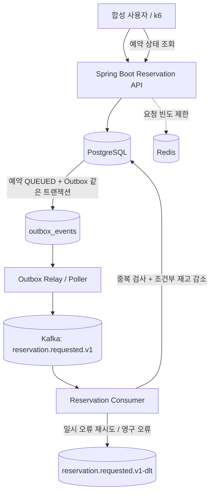
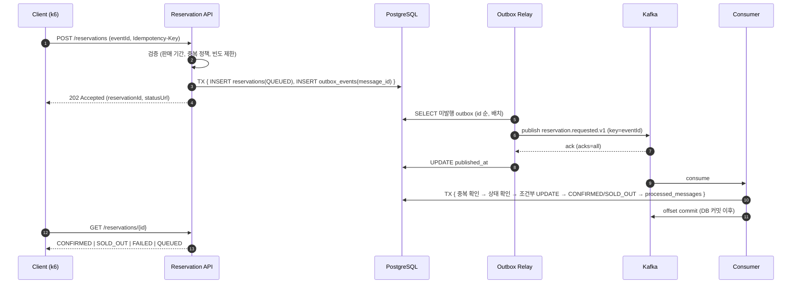
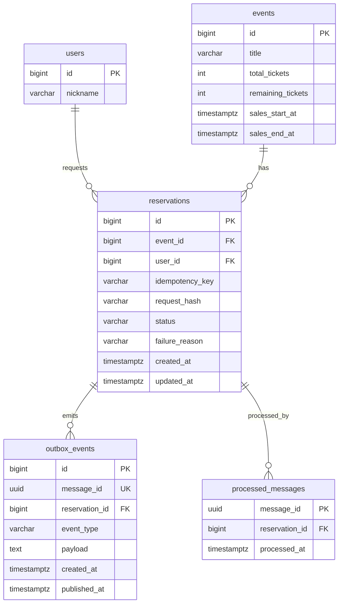

# TicketFlow Kafka — PRD (Product Requirements Document)

| 항목 | 내용 |
| --- | --- |
| 문서 버전 | v1.1 (Q1·Q2·Q4 결정 반영) |
| 작성일 | 2026-11-20 |
| 원본 | `ticketflow-kafka-project-plan.md` (개발 기획서) |
| 개발 기간 | 2026-11-23 ~ 2027-01-17 (8주) |
| 개발 환경 | Windows 11 + WSL2 + Docker Desktop, RAM 32GB 이상, GPU 불필요 |
| 예산 | 서비스 비용 0원 (로컬 오픈소스만 사용, 전기료 제외) |
| 상태 | 진행 중 — 2주차 구현 완료. 남은 미결 사항은 [§18](#18-미결-사항-open-questions) 참고 |

---

## 0. 요약

- **문제:** 잔여 티켓 100장인 공연에 1,000명이 동시에 예약을 시도하는 상황.
- **해결:** Spring Boot API가 요청을 **접수(202)** 하고, Transactional Outbox → Kafka → Consumer 경로로 **비동기 확정**한다.
- **정확성의 근거는 Kafka가 아니라 PostgreSQL**이다. 조건부 `UPDATE`와 트랜잭션, UNIQUE·CHECK 제약이 초과 판매와 중복 확정을 막는다.
- **Kafka의 역할:** 대량 요청의 비동기 완충, 이벤트 전달, Consumer 확장과 장애 복구.
- **최종 산출물:** 재현 가능한 로컬 환경, Testcontainers 통합 테스트, 장애 실험 기록, 동기 방식과 비동기 방식을 같은 조건에서 비교한 실측 벤치마크 보고서.

---

## 1. 배경 및 문제 정의

### 1.1 가상 업무 상황

- 인기 공연의 잔여 티켓은 **100장**이다.
- 이벤트 오픈과 동시에 **고유 사용자 1,000명**이 예약을 시도한다.
- API 서버는 예약을 먼저 접수하고, 처리 요청은 Kafka 이벤트로 비동기 전달한다.
- 예약 확정과 매진 처리는 비동기로 진행되지만, **확정된 티켓 수는 절대 100장을 넘으면 안 된다.**
- Kafka 메시지가 중복 소비되거나 Consumer가 중단·재시작되어도 예약 상태는 일관되어야 한다.

### 1.2 해결해야 할 문제

| # | 문제 | 발생 원인 | 해결 수단 |
| --- | --- | --- | --- |
| P1 | 초과 판매 | 동시 요청이 같은 재고를 동시에 읽고 감소 | DB 조건부 `UPDATE` + `CHECK` 제약 |
| P2 | 중복 예약 | 클라이언트 재시도, 같은 요청의 반복 전송 | 멱등성 키 + `UNIQUE` 제약 |
| P3 | DB와 메시지 불일치 | DB 커밋 후 Kafka 발행 전에 장애 발생 | Transactional Outbox |
| P4 | 중복 처리 | at-least-once 전달, Outbox 재발행, 오프셋 미커밋 | `processed_messages` + 예약 상태 확인 |
| P5 | 처리 유실·정체 | Consumer 장애, 영구 오류 메시지 | 재시도 정책 + DLT + 재처리 기록 |

### 1.3 핵심 설계 원칙

1. **Kafka를 도입했다고 초과 판매가 자동으로 막히지는 않는다.** 정확성은 DB 트랜잭션이 보장한다.
2. 메시지 전달은 항상 **at-least-once**로 가정한다. 모든 Consumer 처리는 멱등해야 한다.
3. **202 Accepted는 좌석 확보가 아니라 접수 완료**를 뜻한다. 문서·응답·UI 어디에서도 202를 확정으로 표현하지 않는다.
4. 엄격한 도착 순서를 지키는 '공정한 대기열'은 MVP 범위 밖이다. HTTP 도착 순서, Outbox 발행 순서, Kafka 파티션 순서는 완전히 일치하지 않을 수 있다.
5. 실측 수치는 과장하지 않는다. PC 사양과 실험 조건을 항상 함께 기록한다.

---

## 2. 목표와 비목표

### 2.1 목표

| ID | 목표 | 측정 방법 |
| --- | --- | --- |
| G1 | **정확성:** 초과 판매 0, 중복 확정 0 | 재고 불변식 SQL (§12.3) |
| G2 | **내결함성:** 중복 메시지·Consumer 재시작·Outbox 재발행에도 상태 일관성 유지 | MSG-01~04 테스트 |
| G3 | **관측 가능성:** 접수 p95, 확정 p95, Consumer lag, 오류율 실측 | k6 + Micrometer (§13) |
| G4 | **재현성:** 다른 개발자가 README만 보고 로컬에서 실행·테스트 가능 | Compose + Flyway + Testcontainers + CI |
| G5 | **비교 분석:** 동기 DB 처리와 Kafka 비동기 처리를 같은 조건으로 비교 | `docs/benchmark-report.md` |

### 2.2 비목표 (이번 범위에서 하지 않는 것)

- 실제 결제, 외부 공연 API 연동
- 실서비스 대상 트래픽 발생 (부하 테스트는 소유한 로컬 환경에서만)
- 대규모 MSA, 별도 서비스 레포 분리
- 실제 개인정보 수집 (합성 사용자만 사용)
- Kubernetes 운영, 고가용성 Kafka 클러스터
- 엄격한 선착순(공정 대기열) 보장
- 예약 만료·취소·재고 복원 → **2차 버전**으로 분리

---

## 3. 사용자와 시나리오

### 3.1 사용자 유형

| 유형 | 설명 | 주요 행동 |
| --- | --- | --- |
| 테스트 사용자 | 합성 계정 (실제 개인정보 없음) | 예약 요청, 상태 조회, 내 예약 목록 |
| 테스트 관리자 | 로컬 환경 전용 | 행사 등록, 현황·지표 조회 |
| 운영자 | 장애 대응 담당 (관리자와 같은 계정이어도 됨) | DLT 확인, 재처리 이력 점검 |
| 부하 생성기 | k6 | 대량 예약 요청, 상태 polling |

### 3.2 핵심 시나리오 — 100장 / 1,000명

1. 관리자가 총 100장인 행사를 등록한다.
2. 판매 시작 시각에 k6가 고유 사용자 1,000명으로 예약 요청을 보낸다.
3. 모든 유효 요청은 `202 Accepted`와 `reservationId`를 받는다 (상태 `QUEUED`).
4. Consumer가 이벤트를 처리해 100건은 `CONFIRMED`, 900건은 `SOLD_OUT`이 된다.
5. 사용자는 `GET /reservations/{id}`를 polling해서 최종 결과를 확인한다.
6. 처리가 끝난 뒤 `remaining_tickets = 0`, `CONFIRMED = 100`이다.

### 3.3 사용자 스토리

- 테스트 사용자로서, 요청이 몰려도 즉시 접수 응답을 받고 싶다. 그래야 타임아웃 없이 결과를 기다릴 수 있다.
- 테스트 사용자로서, 네트워크 오류로 같은 요청을 다시 보내도 예약이 두 건 생기지 않기를 원한다.
- 운영자로서, 처리에 실패한 메시지가 어디에 왜 남았는지 확인하고 싶다.
- 개발자로서, Consumer를 강제로 종료했다가 다시 시작해도 확정 건수가 정확한지 검증하고 싶다.

---

## 4. 성공 기준 (Definition of Done)

| ID | 완료 기준 | 검증 수단 |
| --- | --- | --- |
| DoD-1 | 100장에 대해 고유 예약 시도 1,000건 → 모든 이벤트 처리 완료 후 **최종 `CONFIRMED`가 정확히 100건** | LOAD-01 + 불변식 SQL |
| DoD-2 | 중복 요청, 중복 Kafka 메시지, Consumer 재시작 상황에서 초과 판매·중복 확정 **0건** | CON-01, MSG-01~03 |
| DoD-3 | DB 커밋과 Kafka 발행 사이 장애를 Outbox로 재현하고 복구 결과를 문서화 | `experiments/outbox-republish.md` |
| DoD-4 | 부하 단계별 접수 p95, 확정 p95, Consumer lag, 오류율의 **실측 그래프** | `docs/benchmark-report.md` |
| DoD-5 | Testcontainers 통합 테스트와 GitHub Actions CI 통과 | `.github/workflows/` |
| DoD-6 | README에 Kafka 도입 이유, 보장하는 것과 보장하지 않는 것, 장애 대응 방법 명시 | `README.md` |
| DoD-7 | 동기 DB 처리와 Kafka 비동기 처리를 **같은 실험 조건**으로 비교 (Kafka가 항상 빠르다고 주장하지 않음) | `docs/benchmark-report.md` |

---

## 5. 범위와 우선순위

| 우선순위 | 기능 | 요구사항 ID |
| --- | --- | --- |
| **P0** | 공연 등록·조회 | FR-EVT-01~03 |
| **P0** | 예약 접수 API (202 + requestId) | FR-RSV-01 |
| **P0** | 멱등성 키 / 중복 요청 방어 | FR-RSV-02~03 |
| **P0** | 예약 상태 조회 | FR-RSV-04~05 |
| **P0** | Outbox 기록·발행 | FR-OBX-01~03 |
| **P0** | Kafka Consumer 처리 | FR-CSM-01~02 |
| **P0** | 재고 원자적 감소 | FR-INV-01~03 |
| **P1** | Consumer 장애 복구 (재시도·DLT·재처리 기록) | FR-CSM-03~04 |
| **P1** | Redis 요청 빈도 제한 | FR-RL-01~02 |
| **P1** | 운영 지표·보고서 | FR-OBX-04, FR-OPS-01, FR-OPS-03 |
| **P1** | 벤치마크용 동기 처리 비교 모드 | FR-BMK-01 |
| P2 (후순위) | DLT 조회 API, Prometheus + Grafana 대시보드 | FR-OPS-02, FR-OPS-03 |
| 2차 버전 | 예약 만료·취소·재고 복원, 실제 인증·인가 | — |

---

## 6. 기능 요구사항

### 6.1 행사 (Event)

| ID | 요구사항 | 수용 기준 |
| --- | --- | --- |
| FR-EVT-01 | 관리자는 행사명, 판매 시작·종료 시각, 총 수량으로 행사를 등록한다. 등록 시 `remaining_tickets = total_tickets`. **로컬 프로필에서만 허용.** | 100장 행사 생성 후 조회하면 `remaining = 100` |
| FR-EVT-02 | 사용자는 행사 목록을 조회한다. | 등록한 행사가 목록에 나타남 |
| FR-EVT-03 | 사용자는 행사 상세와 남은 재고를 조회한다. | 확정이 진행될수록 잔여 수량이 감소 |

### 6.2 예약 접수·조회 (Reservation)

| ID | 요구사항 | 수용 기준 |
| --- | --- | --- |
| FR-RSV-01 | `POST /api/v1/reservations` — 요청 본문 `eventId`, 헤더 `Idempotency-Key`. 행사 존재 여부, 판매 기간, 키 형식, 사용자 식별을 검증한 뒤 **하나의 DB 트랜잭션에서** `reservations(status=QUEUED)`와 `outbox_events`를 함께 저장한다. | `202 Accepted` + `reservationId`, `status=QUEUED`, `statusUrl` 반환. 트랜잭션이 실패하면 둘 다 저장되지 않음 |
| FR-RSV-02 | 같은 사용자가 같은 `Idempotency-Key`와 같은 본문으로 다시 요청하면 **새 예약을 만들지 않고 기존 예약을 반환**한다. 같은 키에 다른 본문이 오면 `409 Conflict`. | CON-01: 10회 반복 요청해도 예약 1건 |
| FR-RSV-03 | 같은 사용자의 같은 행사 예약은 1건으로 제한한다 (`UNIQUE(event_id, user_id)`). 다른 멱등성 키로 다시 요청해도 새 예약은 생성되지 않는다. | 결정: `409 RESERVATION_ALREADY_EXISTS` + 기존 `reservationId` 반환 ([Q2](#18-미결-사항-open-questions)) |
| FR-RSV-04 | `GET /api/v1/reservations/{id}` — `QUEUED`, `CONFIRMED`, `SOLD_OUT`, `FAILED` 중 하나를 반환한다. **본인 또는 관리자만** 조회할 수 있다. | 다른 사용자 예약을 조회하면 `404` (존재 여부를 드러내지 않음) |
| FR-RSV-05 | `GET /api/v1/users/me/reservations` — 내 예약 목록을 조회한다. | 본인 예약만 반환 |

### 6.3 Transactional Outbox

| ID | 요구사항 | 수용 기준 |
| --- | --- | --- |
| FR-OBX-01 | 예약 저장과 같은 트랜잭션에서 Outbox 행을 기록한다. **`message_id`(UUID)는 이 시점에 생성해 저장**하고, 이후 재발행할 때도 같은 값을 사용한다. | API가 성공하면 Outbox 행이 반드시 존재 |
| FR-OBX-02 | Relay(Poller)가 `published_at IS NULL`인 행을 `id` 순으로 일정 배치씩 읽어 Kafka에 발행하고, **브로커 ack를 받은 뒤** `published_at`을 갱신한다. | Kafka가 일시 중단돼도 복구 후 미발행 건이 모두 발행됨 |
| FR-OBX-03 | 발행 후 `published_at`을 갱신하기 전에 장애가 나면 같은 메시지가 재발행될 수 있다. 이 경우를 정상 시나리오로 취급한다. | MSG-03: 재발행돼도 재고는 한 번만 감소 |
| FR-OBX-04 | 미발행 건수와 가장 오래 대기한 시간을 지표로 노출한다. | Actuator/Micrometer에서 조회 가능 |

### 6.4 Kafka Consumer

| ID | 요구사항 | 수용 기준 |
| --- | --- | --- |
| FR-CSM-01 | `reservation.requested.v1`을 소비해 **하나의 DB 트랜잭션에서** 아래 순서로 처리한다. ① `processed_messages`에 `message_id`가 있으면 건너뜀 ② 예약이 이미 최종 상태면 건너뜀 ③ 조건부 `UPDATE`로 재고 감소 ④ 1행이면 `CONFIRMED`, 0행이면 원인을 구분해 `SOLD_OUT` 또는 `FAILED` ⑤ `processed_messages` 기록 ⑥ 커밋 → **커밋이 끝난 뒤 오프셋 커밋** | MSG-01: 같은 `messageId`를 두 번 소비해도 재고는 1회만 감소 |
| FR-CSM-02 | `SOLD_OUT`은 정상적인 업무 결과다. 재시도하거나 DLT로 보내지 않는다. | 매진 이후 메시지가 재시도 루프에 빠지지 않음 |
| FR-CSM-03 | 일시 오류(DB 연결, 타임아웃)는 정해진 횟수만큼 재시도한다. 영구 오류(역직렬화 실패, 스키마 오류)는 재시도 없이 `reservation.requested.v1-dlt`로 보낸다. DLT 이동 이력(원본 토픽·파티션·오프셋·오류 원인)을 남긴다. | MSG-04: 스키마 오류 메시지가 DLT로 이동하고 감사 이력이 남음 |
| FR-CSM-04 | Consumer가 처리 전, 처리 중, DB 커밋 직후에 중단돼도 재시작하면 남은 메시지를 다시 처리하고 유실·중복 확정이 없다. | MSG-02 |

### 6.5 재고 (Inventory)

| ID | 요구사항 | 수용 기준 |
| --- | --- | --- |
| FR-INV-01 | 모든 재고 변경은 아래 조건부 `UPDATE` 한 문장으로 처리한다. 애플리케이션에서 읽고 계산한 뒤 쓰는 방식은 금지한다. | CON-02: 재고 1장에 동시 처리해도 확정 1건 |
| FR-INV-02 | `events`에 `CHECK (remaining_tickets BETWEEN 0 AND total_tickets)` 제약을 둔다. | 음수 재고를 DB가 거부 |
| FR-INV-03 | 재고를 확보한 뒤 다른 단계에서 실패하면 트랜잭션을 롤백해 재고와 예약 상태를 함께 원복한다. | 강제 예외 테스트에서 재고·상태가 함께 원복 |

```sql
UPDATE events
   SET remaining_tickets = remaining_tickets - 1
 WHERE id = :eventId
   AND remaining_tickets > 0
   AND sales_start_at <= CURRENT_TIMESTAMP
   AND sales_end_at   >  CURRENT_TIMESTAMP;
-- 영향받은 행 1 → 재고 확보 성공 / 0 → 매진 또는 판매 기간 외 (원인 구분 필요)
```

### 6.6 요청 빈도 제한 (P1)

| ID | 요구사항 | 수용 기준 |
| --- | --- | --- |
| FR-RL-01 | Redis로 사용자별 예약 시도 빈도를 제한하고, 초과하면 `429 Too Many Requests`를 반환한다. | SEC-01: 같은 사용자의 반복 요청이 억제됨 |
| FR-RL-02 | 빈도 제한은 **부하 완화 수단일 뿐 정확성 보장 수단이 아니다.** Redis 장애 시 정책을 정의한다. | 제안: fail-open ([Q5](#18-미결-사항-open-questions)) |

### 6.7 운영·관리 (P1~P2)

| ID | 요구사항 | 수용 기준 |
| --- | --- | --- |
| FR-OPS-01 | `GET /api/v1/admin/metrics` — 행사별 상태 건수, 잔여 재고, Outbox 미발행 건수, Consumer lag | 부하 테스트 전후 비교 가능 |
| FR-OPS-02 | `GET /api/v1/admin/dlt` — DLT 메시지와 실패 원인 조회 (P2) | 운영자가 실패 원인을 확인 가능 |
| FR-OPS-03 | Actuator + Micrometer로 지표를 노출한다. Prometheus + Grafana는 P2. | `/actuator/health`, `/actuator/metrics` 응답 |

### 6.8 벤치마크 비교 모드 (P1)

| ID | 요구사항 | 수용 기준 |
| --- | --- | --- |
| FR-BMK-01 | DoD-7을 위해 **동기 처리 모드**를 둔다. 같은 API로 요청을 받되 Kafka 없이 요청 트랜잭션 안에서 재고 감소와 확정까지 처리한다. 설정(프로필 또는 플래그)으로 전환하며 기본값은 비활성. | 같은 k6 스크립트·데이터 조건으로 두 모드를 측정 가능 |

---

## 7. 비기능 요구사항

| 분류 | ID | 요구사항 |
| --- | --- | --- |
| 정확성 | NFR-ACC-01 | 어떤 장애 조합에서도 `remaining_tickets >= 0`, `CONFIRMED <= total_tickets` |
| 정확성 | NFR-ACC-02 | MVP(취소 없음)에서는 항상 `CONFIRMED + remaining_tickets = total_tickets` |
| 신뢰성 | NFR-REL-01 | Kafka 전달을 at-least-once로 가정하고 모든 Consumer 처리를 멱등하게 구현 |
| 신뢰성 | NFR-REL-02 | 일시 오류와 영구 오류를 구분해 재시도 또는 DLT로 처리 |
| 성능 | NFR-PERF-01 | 고정 목표치는 두지 않는다. 50→100→300→500 RPS 단계에서 접수 p95, 확정 p95, 오류율, lag를 **측정하고 분석**하는 것이 요구사항 |
| 성능 | NFR-PERF-02 | 모든 측정 결과에 하드웨어 사양, Docker 리소스 설정, 데이터 초기화 조건을 기록 |
| 보안 | NFR-SEC-01 | 호스트 포트는 `127.0.0.1`에만 바인딩. 브로커를 외부에 개방하지 않음 |
| 보안 | NFR-SEC-02 | 비밀값은 `.env`에만 두고 Git에는 `.env.example`만 커밋 |
| 보안 | NFR-SEC-03 | 테스트용 사용자 식별 방식은 로컬 프로필에서만 동작. `X-User-Id` 같은 임의 헤더를 실서비스 인증으로 쓰지 않음. 공개 배포 전 실제 인증·인가 필수 |
| 보안 | NFR-SEC-04 | 부하 테스트는 소유한 로컬 환경에서만 실행 |
| 재현성 | NFR-REP-01 | `docker compose`로 인프라 일괄 실행, Flyway로 스키마 초기화 |
| 재현성 | NFR-REP-02 | 컨테이너 이미지는 버전 태그를 고정 (`latest` 금지) |
| 재현성 | NFR-REP-03 | 통합 테스트는 Testcontainers로 실제 Kafka·PostgreSQL을 사용 |
| 정직성 | NFR-HON-01 | 202를 확정으로 설명하지 않고, 실측 수치를 과장하지 않으며, Kafka 방식이 항상 빠르다고 주장하지 않음 |

---

## 8. 시스템 아키텍처

### 8.1 구성도



### 8.2 컴포넌트 책임

| 컴포넌트 | 책임 | 하지 않는 것 |
| --- | --- | --- |
| Reservation API | 검증, 멱등 처리, 예약·Outbox 저장, 202 반환, 상태 조회 | 재고 감소 (동기 비교 모드 제외) |
| Outbox Relay | 미발행 Outbox를 Kafka로 발행하고 `published_at` 갱신 | 업무 로직 |
| Reservation Consumer | 중복 검사, 조건부 재고 감소, 최종 상태 전이 | HTTP 응답 |
| PostgreSQL | **정확성의 최종 근거** (트랜잭션, 제약) | — |
| Kafka | 비동기 완충, 전달, 재소비 | 정확성 보장 |
| Redis | 요청 빈도 제한, 선택적 조회 캐시 | 재고·예약의 원본 데이터 |

배포 형태는 **하나의 Spring Boot 코드베이스**다. API, Relay, Consumer를 패키지(논리 모듈)로 나누고, 필요하면 `api`/`worker` 프로필로 같은 코드를 별도 프로세스로 띄워 확장한다. 처음부터 별도 MSA 레포를 만들지 않는다.

### 8.3 예약 처리 흐름



### 8.4 보장하는 것과 보장하지 않는 것

| 보장하는 것 | 보장하지 않는 것 |
| --- | --- |
| 확정 수 ≤ 총 수량, 잔여 재고 ≥ 0 | 엄격한 HTTP 도착 순서대로의 선착순 |
| 같은 예약 요청의 중복 확정 0 | 202 응답 시점의 좌석 확보 |
| API 성공 후 이벤트 유실 없음 (Outbox) | 메시지 정확히 한 번 전달 (전달은 at-least-once, **업무 결과만 1회 적용**) |
| Consumer 재시작 후 처리 재개 | 단일 노드 Kafka의 고가용성 |
| 영구 오류 메시지의 DLT 격리와 이력 | 로컬 측정 수치의 운영 환경 재현 |

---

## 9. 데이터 모델

### 9.1 ERD



### 9.2 테이블과 제약 조건

| 테이블 | 핵심 컬럼 | 제약·인덱스 |
| --- | --- | --- |
| `users` | id, nickname | PK(id). 테스트용 합성 계정만 |
| `events` | id, title, total_tickets, remaining_tickets, sales_start_at, sales_end_at | CHECK(total_tickets >= 0), CHECK(remaining_tickets BETWEEN 0 AND total_tickets), CHECK(sales_start_at < sales_end_at) |
| `reservations` | id, event_id, user_id, idempotency_key, request_hash, status, failure_reason, created_at, updated_at | UNIQUE(event_id, user_id), UNIQUE(user_id, idempotency_key), FK(event_id), FK(user_id), INDEX(status, created_at), CHECK(status IN (...)) |
| `outbox_events` | id, message_id, reservation_id, event_type, payload, created_at, published_at | UNIQUE(message_id), FK(reservation_id), INDEX(published_at, created_at) — 미발행 조회용 부분 인덱스 `WHERE published_at IS NULL` 검토 |
| `processed_messages` | message_id, reservation_id, processed_at | PK(message_id), FK(reservation_id) |

> **원본 대비 추가 컬럼:** `reservations.request_hash`(같은 키·다른 본문 판별용 409), `reservations.failure_reason`(`FAILED` 원인 기록), `outbox_events.message_id`(재발행 시 같은 ID 유지), `outbox_events.created_at`(원본 ERD에 누락). 상세는 [부록 A](#부록-a-원본-기획서-대비-보완-사항).

### 9.3 예약 상태 전이

```text
QUEUED ──┬──> CONFIRMED   재고 확보 성공
         ├──> SOLD_OUT    재고 없음 (정상 업무 결과, 재시도 안 함)
         └──> FAILED      복구 불가능한 업무·시스템 실패 (failure_reason 기록)
```

- `CONFIRMED`, `SOLD_OUT`, `FAILED`는 **최종 상태**다. 최종 상태에서 다른 상태로 전이하지 않는다.
- 상태 변경은 `UPDATE ... WHERE id = ? AND status = 'QUEUED'` 형태로 수행해 이미 처리된 예약을 다시 바꾸지 않는다.
- `FAILED`와 DLT 재처리는 운영자가 원인을 확인할 수 있어야 하며, DB 상태와 Kafka 오프셋의 일관성을 점검한다.
- 예약 만료·취소·재고 복원은 2차 버전에서 다룬다 (상태 전이가 더 복잡해짐).

---

## 10. 이벤트 계약 (Kafka)

### 10.1 토픽 설정

| 항목 | 값 | 근거 |
| --- | --- | --- |
| 실행 모드 | KRaft single-node (로컬) | ZooKeeper 없는 로컬 구성. 프로덕션 HA를 대신하지 않음 |
| 토픽 | `reservation.requested.v1` | 예약 접수 이벤트 |
| DLT | `reservation.requested.v1-dlt` | 영구 오류 격리. 라이브러리 기본 접미사에 기대지 말고 이름을 명시적으로 설정 |
| Key | `eventId` | 같은 행사 이벤트를 같은 파티션으로 보냄 |
| Producer | `acks=all`, 재시도, idempotent producer | 브로커 측 중복 위험 완화 (업무 멱등성은 별도) |
| Consumer | DB 커밋 성공 후 오프셋 커밋 | 재소비되어도 DB가 멱등 처리 |
| 순서 | 파티션 안의 순서만 가정 | 전체 사용자 선착순은 보장하지 않음 |

### 10.2 메시지 스키마 (v1)

```json
{
  "messageId": "6f1c2a9e-0b7d-4d7e-9a51-3c2f0d8e4b11",
  "schemaVersion": 1,
  "reservationId": 1024,
  "eventId": 7,
  "occurredAt": "2026-11-23T10:00:00Z"
}
```

| 필드 | 타입 | 설명 |
| --- | --- | --- |
| `messageId` | UUID | Outbox 저장 시 생성. 재발행해도 같은 값. Consumer 중복 판별 키 |
| `schemaVersion` | int | 스키마 버전. 호환되지 않는 변경은 새 토픽(`.v2`)으로 분리 |
| `reservationId` | long | 처리 대상 예약 |
| `eventId` | long | 행사 ID (메시지 key와 같음) |
| `occurredAt` | ISO-8601 UTC | 예약 접수 시각 |

### 10.3 설계상 주의점

- **핫 파티션:** key가 `eventId`라서 인기 행사 하나의 요청은 모두 한 파티션으로 간다. 파티션을 늘려도 **행사 하나의 처리는 Consumer 하나가 순차 처리**한다. 덕분에 같은 행 잠금 경합은 줄지만, 행사 하나의 처리량 상한이 생긴다. 벤치마크에서 이 상한을 측정하고 기록한다.
- **CON-02 병렬 Consumer 테스트:** 같은 행사의 메시지는 Kafka 경로로는 병렬 처리되지 않는다. 따라서 Consumer 처리 로직을 여러 스레드에서 동시에 호출하는 서비스 수준 테스트로 DB 동시성을 검증한다.
- **`@RetryableTopic` 사용 시:** non-blocking retry는 원본 토픽 순서를 보존하지 않을 수 있다. 같은 예약에 순서 의존 작업이 늘어나면 별도 상태 전이·재처리 정책을 설계한다.

---

## 11. API 명세

기본 경로 `/api/v1`. 상세 명세는 구현 후 `docs/api-spec.md`와 Swagger(OpenAPI)로 관리한다.

### 11.1 엔드포인트

| Method | Endpoint | 권한 | 성공 응답 | 비고 |
| --- | --- | --- | --- | --- |
| POST | `/events` | 테스트 관리자 | 201 | 로컬 프로필에서만 허용 |
| GET | `/events` | 테스트 사용자 | 200 | 행사 목록 |
| GET | `/events/{eventId}` | 테스트 사용자 | 200 | 행사 정보와 남은 재고 |
| POST | `/reservations` | 인증된 테스트 사용자 | **202** (최초) / 200 (재요청) | `Idempotency-Key` 헤더 필수 |
| GET | `/reservations/{reservationId}` | 예약자 / 관리자 | 200 | 4가지 상태 중 하나 |
| GET | `/users/me/reservations` | 예약자 | 200 | 내 예약 목록 |
| GET | `/admin/metrics` | 관리자 | 200 | 예약 현황과 지표 |
| GET | `/admin/dlt` | 관리자 | 200 | 실패 이벤트 확인 (P2) |

### 11.2 예약 요청·응답 예시

```http
POST /api/v1/reservations
Content-Type: application/json
Idempotency-Key: demo-user42-concert7-attempt1

{ "eventId": 7 }
```

```http
HTTP/1.1 202 Accepted
Location: /api/v1/reservations/1024

{
  "reservationId": 1024,
  "eventId": 7,
  "status": "QUEUED",
  "statusUrl": "/api/v1/reservations/1024"
}
```

### 11.3 응답 코드 정책

| 코드 | 상황 |
| --- | --- |
| 202 | 최초 접수 성공 (확정 아님) |
| 200 | 같은 사용자·같은 키·같은 본문의 재요청 → 기존 예약과 현재 상태 반환 (결정, [Q1](#18-미결-사항-open-questions)) |
| 400 | 요청 형식 오류, `Idempotency-Key` 누락·형식 오류 |
| 401 | 사용자 식별 실패 (테스트 헤더 없음·형식 오류·미등록 사용자, 테스트 인증 비활성) |
| 404 | 행사 또는 예약 없음. 다른 사용자의 예약도 404 |
| 409 | 같은 키에 다른 본문(`IDEMPOTENCY_KEY_REUSED`), 또는 같은 사용자·같은 행사의 다른 키 요청(`RESERVATION_ALREADY_EXISTS`) (결정, [Q2](#18-미결-사항-open-questions)) |
| 422 | 판매 기간 외 요청 |
| 429 | 요청 빈도 제한 초과 |
| 5xx | 서버 오류 (지표에서 4xx와 분리 집계) |

### 11.4 오류 응답 형식

```json
{
  "code": "RESERVATION_CONFLICT",
  "message": "이미 해당 행사에 접수된 예약이 있습니다.",
  "reservationId": 1024
}
```

---

## 12. 검증 계획

### 12.1 필수 테스트

| ID | 테스트 | 조건 | 합격 기준 | 수단 | 주차 |
| --- | --- | --- | --- | --- | --- |
| CON-01 | 동일 요청 중복 | 사용자·행사·멱등성 키가 같은 요청 10회 | 예약 1건만 생성 | 통합 테스트 | 2주 |
| CON-02 | 병렬 Consumer | 재고 1장, 동시 처리 | 확정 1건, 음수 재고 0 | 통합 테스트 (멀티스레드) | 4주 |
| MSG-01 | 중복 Kafka 메시지 | 같은 `messageId` 2회 소비 | 재고 1회만 감소 | Testcontainers | 4주 |
| LOAD-01 | 집중 예약 | 티켓 100장, 고유 사용자 1,000명 | `CONFIRMED = 100`, 초과 판매 0 | k6 + 불변식 SQL | 5주 |
| PERF-01 | 부하 증가 | 50→100→300→500 RPS 단계 | p95, 오류율, lag 측정·분석 | k6 ramp | 5주, 7주 |
| MSG-02 | Consumer 중단 | 처리 전 / 처리 중 / 커밋 직후 프로세스 중단 | 재시작 후 유실·중복 확정 없음 | 실험 (`experiments/consumer-crash.md`) | 6주 |
| MSG-03 | Outbox 재발행 | 발행 후 `published_at` 갱신 전 중단 | 중복 메시지에도 정상 결과 | 실험 (`experiments/outbox-republish.md`) | 6주 |
| MSG-04 | 실패 메시지 | 재시도할 수 없는 스키마 오류 | DLT 이동, 감사 이력 유지 | Testcontainers | 6주 |
| SEC-01 | 과도한 요청 | 같은 사용자의 반복 예약 요청 | 속도 제한 / 중복 억제 동작 | 통합 테스트 + k6 | 7주 |

### 12.2 실험 운영 규칙

- **'가상 사용자 1,000명'과 '초당 1,000요청'은 다른 조건이다.** k6 VU 수, 요청 도착률(RPS), 실행 시간, 데이터 초기화 조건을 매번 명시한다.
- 처음에는 100 VU부터 단계적으로 올리고 로컬 PC의 자원 한계를 기록한다.
- 실험마다 별도의 행사(또는 초기화된 DB 상태)를 사용한다. 시작 전 `remaining_tickets = 100`으로 초기화한다.
- 부하 생성기와 서버가 같은 PC에서 돌면 수치가 PC 자원에 좌우된다. 결과에 하드웨어와 설정을 반드시 표시한다.

### 12.3 재고 불변식 검증 SQL

```sql
SELECT e.id,
       e.total_tickets,
       e.remaining_tickets,
       COUNT(*) FILTER (WHERE r.status = 'CONFIRMED') AS confirmed,
       COUNT(*) FILTER (WHERE r.status = 'QUEUED')    AS still_queued
  FROM events e
  LEFT JOIN reservations r ON r.event_id = e.id
 GROUP BY e.id;
-- 합격: remaining_tickets >= 0
--       confirmed <= total_tickets
--       confirmed + remaining_tickets = total_tickets   (MVP: 취소 없음)
--       still_queued = 0                                (처리 완료 후)
```

---

## 13. 측정 지표

| # | 지표 | 정의 | 수집 방법 |
| --- | --- | --- | --- |
| M1 | 접수 API p95 지연 (ms) | 요청부터 202 반환까지 | k6 `http_req_duration` |
| M2 | 예약 확정 p95 지연 (ms) | 접수(`created_at`)부터 최종 상태 도달(`updated_at`)까지 | DB 집계 또는 k6 polling |
| M3 | RPS와 오류율 (%) | 유효 요청 처리량. 5xx / 429 / 409 분리 | k6 + Actuator |
| M4 | 재고 불변식 | `remaining >= 0`, `CONFIRMED <= total` | §12.3 SQL |
| M5 | 중복 확정 건수 | 같은 예약이 두 번 성공 처리된 건수 (목표 0) | 불변식 SQL + `processed_messages` |
| M6 | Kafka Consumer lag | 유입 대비 처리 지연 | Kafka CLI / Micrometer |
| M7 | Outbox 미발행 건수·최고 대기 시간 | Kafka 연결 장애 탐지 | 커스텀 Micrometer gauge |

---

## 14. 기술 스택과 환경

### 14.1 기술 스택

| 영역 | 기술 | 선정 이유 |
| --- | --- | --- |
| 언어·백엔드 | Java 21, Spring Boot 4.1.x | 트랜잭션, 비즈니스 로직, 테스트 |
| 메시징 | Apache Kafka (KRaft), Spring for Apache Kafka | 이벤트 생산·소비, 재시도, DLT |
| DB | PostgreSQL | 원자적 재고 갱신, 상태 영속화 |
| 데이터 접근 | Spring Data JPA + 재고 감소는 JdbcTemplate / Native SQL | CRUD 생산성과 재고 감소 정확성 |
| 마이그레이션 | Flyway | 변경 이력, 재현 가능한 초기화 |
| 캐시·빈도 제한 | Redis | 예약 시도 빈도 제한, 선택적 조회 캐시 |
| 컨테이너 | Docker Compose + WSL2 | 단일 로컬 실행 환경 |
| 테스트 | JUnit, Testcontainers (Kafka / PostgreSQL) | 중복·장애·트랜잭션 테스트 |
| 성능 | k6, Actuator, Micrometer | RPS, p95, 확정 지연, 오류율 |
| 운영 (후순위) | Prometheus + Grafana | 지표 수집과 시각화 |
| API 문서 | OpenAPI / Swagger | 수동 기능 확인 (Spring Boot 4.x 호환 버전 확인 필요) |

### 14.2 버전·환경 정책

- 모든 컨테이너 이미지는 **버전 태그를 고정**한다. Kafka 공식 이미지의 환경 변수와 Listener 설정은 해당 이미지 버전 문서로 검증한 뒤 Compose를 작성한다.
- Kafka는 개발용 **단일 노드 KRaft**로 시작한다. Kafka UI는 필수가 아니며, 처음에는 CLI와 로그로 토픽을 확인해 리소스를 아낀다.
- Docker Desktop의 메모리 제한과 디스크 여유 공간을 확인한다.
- 사전 점검 명령:

```powershell
java -version
git --version
wsl --status
docker --version
docker compose version
```

---

## 15. 프로젝트 구조

```text
ticketflow-kafka/
├─ prd.md                          # 이 문서
├─ README.md                       # 소개, 실행 가이드, 보장 범위
├─ .env.example                    # 환경 변수 예시 (.env는 커밋 금지)
├─ .gitignore
├─ backend/                        # Spring Boot 단일 코드베이스
│  ├─ build.gradle                 # (1주차 Spring Initializr로 생성)
│  ├─ gradlew.bat                  # (1주차 Spring Initializr로 생성)
│  └─ src/
│     ├─ main/java/com/ticketflow/
│     │  ├─ TicketFlowApplication.java   # (1주차 생성)
│     │  ├─ event/{controller,service,entity,repository}/
│     │  ├─ reservation/{controller,service,entity,repository,dto}/
│     │  ├─ messaging/{producer,consumer,dto,config}/
│     │  ├─ outbox/{entity,repository,relay}/
│     │  ├─ idempotency/{service,entity}/
│     │  ├─ monitoring/{controller,service}/
│     │  └─ global/{config,exception,response}/
│     ├─ main/resources/
│     │  ├─ application.yml        # (1주차 생성)
│     │  └─ db/migration/          # Flyway V1__*.sql ...
│     └─ test/
│        ├─ java/com/ticketflow/{event,reservation,messaging,outbox,support}/
│        └─ resources/
├─ infrastructure/
│  ├─ compose.yml                  # PostgreSQL, Kafka(KRaft), Redis
│  └─ monitoring/                  # Prometheus / Grafana (후순위)
├─ load-tests/
│  ├─ reservation-spike.js         # LOAD-01
│  └─ reservation-ramp.js          # PERF-01
├─ experiments/
│  ├─ duplicate-event.md           # MSG-01
│  ├─ consumer-crash.md            # MSG-02
│  └─ outbox-republish.md          # MSG-03
├─ docs/
│  ├─ architecture.md
│  ├─ database.md
│  ├─ event-contract.md
│  ├─ api-spec.md
│  ├─ benchmark-report.md
│  └─ adr/0001-why-kafka.md
└─ .github/workflows/              # CI (8주차)
```

| 패키지 | 책임 |
| --- | --- |
| `event` | 행사 등록·조회, 재고 조회 |
| `reservation` | 예약 접수·조회 API, 상태 전이, 동기 비교 모드 |
| `idempotency` | 멱등성 키 검증, 요청 해시 비교 |
| `outbox` | Outbox 엔티티, Relay(Poller) |
| `messaging` | Kafka Producer/Consumer 설정, 메시지 DTO, 재시도·DLT 설정 |
| `monitoring` | 관리자 지표 API, 커스텀 Micrometer 지표 |
| `global` | 공통 설정, 예외 처리, 응답 형식 |

---

## 16. 마일스톤 (8주)

| 주차 | 기간 | 목표 | 마일스톤 | 관련 요구사항 |
| --- | --- | --- | --- | --- |
| 1주 | 11/23 ~ 11/29 | Spring Boot 프로젝트, PostgreSQL·Kafka Compose, 행사 API | 헬스 체크, DB 연결, 토픽 송수신 | FR-EVT-* |
| 2주 | 11/30 ~ 12/06 | 예약 테이블, 접수 API, 멱등성 키 | 202 + `QUEUED` | FR-RSV-*, CON-01 |
| 3주 | 12/07 ~ 12/13 | Outbox 트랜잭션, Relay, Kafka Consumer | 접수 → 이벤트 → 예약 완료 | FR-OBX-*, FR-CSM-01 |
| 4주 | 12/14 ~ 12/20 | 원자적 재고 감소, 중복 소비 방지 | 100장 초과 확정 없음 | FR-INV-*, CON-02, MSG-01 |
| 5주 | 12/21 ~ 12/27 | k6 1,000명 시뮬레이션, 병목 분석, 동기 비교 모드 | 재고 불변식 + 성능 보고 | LOAD-01, PERF-01, FR-BMK-01 |
| 6주 | 12/28 ~ 01/03 | Consumer 중단·재시작, 중복 발행, DLT | 장애 복구 테스트 | FR-CSM-03~04, MSG-02~04 |
| 7주 | 01/04 ~ 01/10 | Redis 빈도 제한, 지표·모니터링 | 운영 관측 지표 | FR-RL-*, FR-OPS-*, SEC-01 |
| 8주 | 01/11 ~ 01/17 | 통합 테스트, CI, README, 시연 영상 | 재현 가능한 포트폴리오 | DoD 전체 |

### 16.1 1주차 상세 (2026-11-23 ~ 11-29)

| 날짜 | 할 일 | 완료 조건 |
| --- | --- | --- |
| 월 11/23 | Git 초기화, Java 21 / Spring Boot 프로젝트 생성 (`backend/`) | API 서버 로컬 기동 |
| 화 11/24 | PostgreSQL Compose, Flyway, `events` 테이블 | 100장 행사 생성 성공 |
| 수 11/25 | Kafka KRaft 단일 노드 Compose, 브로커 연결 확인 | 토픽 생성과 메시지 발행 |
| 목 11/26 | Spring Kafka Producer/Consumer 샘플 | 메시지 송수신 테스트 |
| 금 11/27 | 공연 등록·조회 REST API | Swagger로 조회 가능 |
| 토 11/28 | Testcontainers로 Kafka·DB 기본 통합 테스트 | CI 없이 로컬 테스트 통과 |
| 일 11/29 | 구조도, ADR(왜 Kafka인가), README·실행 가이드 | 다른 개발자가 로컬 실행 가능 |

> **1주차 원칙:** Kafka 연결은 먼저 확인하되, 재고·예약 비즈니스 로직은 2~4주차에 도입한다. 첫 주에 모든 컴포넌트를 한꺼번에 완성하려 하지 않는다.

---

## 17. 리스크와 대응

| 리스크 | 영향 | 대응 |
| --- | --- | --- |
| 같은 PC에서 부하 생성기와 서버를 함께 실행 | 수치가 PC 자원에 좌우됨 | 사양·설정 기록, 100 VU부터 단계적 증가, 상대 비교 중심 해석 |
| `eventId` key로 인한 핫 파티션 | 행사 하나의 처리량 상한 | 상한을 측정·문서화. 확장 방안(파티션 내 배치 처리 등)은 보고서에서 논의 |
| Spring Boot 4.x와 주변 라이브러리 호환성 (springdoc 등) | 1주차 지연 | 1주차 월요일에 의존성 호환성 먼저 확인 |
| Kafka Compose Listener 설정 오류 | 호스트↔컨테이너 연결 실패 | 고정 태그 이미지 문서 기준으로 검증, 연결 확인 스크립트 |
| Outbox 폴링 주기·배치 크기 | 확정 지연 증가 또는 DB 부하 | 주기·배치 크기를 설정값으로 두고 벤치마크로 튜닝 |
| Relay 다중 인스턴스 시 중복 발행 증가 | 불필요한 중복 메시지 | MVP는 단일 Relay. 확장 시 `FOR UPDATE SKIP LOCKED` 검토 |
| Redis 장애 | 예약 API 전체 차단 가능성 | fail-open 정책 (정확성은 DB가 보장) |
| 범위 확장 (취소, 결제, MSA) | 일정 초과 | §2.2 비목표 준수, 2차 버전으로 분리 |

---

## 18. 미결 사항 (Open Questions)

구현 전에 결정이 필요한 항목이다. **제안**은 PRD 작성 시점의 기본안이며, 확정되면 ✅로 표시한다.
2026-11-20: Q1·Q2·Q4를 제안안대로 결정하고 2주차에 구현했다.

| # | 질문 | 제안 / 결정 | 결정 시점 |
| --- | --- | --- | --- |
| Q1 | 같은 사용자·키·본문 재요청의 응답 코드는? | ✅ **결정:** 최초 202, 재요청은 200 + 기존 예약의 현재 상태 | 2주차 |
| Q2 | 같은 사용자·같은 행사에 **다른 키**로 요청하면? | ✅ **결정:** 409 `RESERVATION_ALREADY_EXISTS` + 기존 `reservationId` | 2주차 |
| Q3 | 판매 기간 안에 접수됐지만 종료 후 소비된 메시지는? | `FAILED` + `failure_reason=SALES_CLOSED`. 대안: 판매 기간 검증을 접수 시점 기준으로만 하고 Consumer에서는 생략 | 4주차 |
| Q4 | MVP 사용자 식별 방식은? | ✅ **결정:** `X-Test-User-Id` 헤더(관리자는 `X-Test-User-Role: ADMIN`). `ticketflow.test-auth.enabled`가 켜진 `local` 프로필에서만 동작하고, 꺼져 있으면 401. 합성 사용자 1~1000은 local 전용 시드 | 2주차 |
| Q5 | Redis 장애 시 빈도 제한 정책은? | fail-open (요청 허용 + 경고 지표) | 7주차 |
| Q6 | 토픽 파티션 수는? | 3 (핫 파티션 특성상 행사 하나의 처리량은 늘지 않음을 보고서에 명시) | 3주차 |
| Q7 | Outbox `payload` 타입은 `text`와 `jsonb` 중 무엇으로? | 원본대로 `text`로 시작. 조회 필요가 생기면 `jsonb` 전환 | 3주차 |

---

## 19. 용어

| 용어 | 의미 |
| --- | --- |
| 접수 | 예약 요청이 DB에 `QUEUED`로 저장되고 202를 반환한 상태. 좌석 확보가 아님 |
| 확정 | Consumer가 재고를 감소시키고 `CONFIRMED`로 바꾼 상태 |
| 멱등성 | 같은 요청이나 메시지를 여러 번 처리해도 결과가 한 번 처리한 것과 같은 성질 |
| Transactional Outbox | 업무 데이터와 발행할 이벤트를 같은 DB 트랜잭션에 기록하고, 별도 Relay가 발행하는 패턴 |
| at-least-once | 메시지가 최소 한 번 전달됨. 중복 전달될 수 있음 |
| DLT | Dead Letter Topic. 처리할 수 없는 메시지를 격리하는 토픽 |
| Consumer lag | 토픽에 쌓인 메시지 중 Consumer가 아직 처리하지 못한 양 |
| VU | k6 가상 사용자 (Virtual User). 요청 도착률(RPS)과는 다른 개념 |

---

## 20. 참고 문서

- Apache Kafka KRaft: https://kafka.apache.org/42/operations/kraft/
- Apache Kafka Getting Started: https://kafka.apache.org/44/getting-started/
- Spring Kafka Reference: https://docs.spring.io/spring-kafka/reference/
- Spring Kafka Retry/DLT: https://docs.spring.io/spring-kafka/reference/retrytopic/how-the-pattern-works.html
- Spring Boot 시스템 요구사항: https://docs.spring.io/spring-boot/system-requirements.html
- k6 시나리오: https://grafana.com/docs/k6/latest/using-k6/scenarios/
- Testcontainers Kafka: https://java.testcontainers.org/modules/kafka/
- PostgreSQL 공식 문서: https://www.postgresql.org/docs/

---

## 부록 A. 원본 기획서 대비 보완 사항

| # | 원본 | 보완 내용 | 이유 |
| --- | --- | --- | --- |
| A1 | Consumer 처리 이력 테이블 이름이 `processed_events`(§3)와 `processed_messages`(§4~5, §11)로 섞여 있음 | `processed_messages`로 통일 | 이름 혼동 방지 |
| A2 | Kafka 메시지에 `messageId`가 있지만 생성 시점이 정의되지 않음 | `outbox_events.message_id`를 Outbox 저장 시 생성하고 재발행 때도 재사용 | 발행할 때마다 새로 만들면 MSG-03 재발행 시 `processed_messages`로 중복을 거를 수 없음 |
| A3 | "같은 키에 다른 본문이면 409"의 판별 방법 없음 | `reservations.request_hash` 추가 | 기존 요청 본문과 비교할 근거 필요 |
| A4 | `FAILED` 원인을 기록할 곳 없음 | `reservations.failure_reason` 추가 | 운영자 원인 확인 요구사항(원본 §5) 충족 |
| A5 | ERD의 `outbox_events`에 `created_at` 누락 (테이블 표에는 있음) | ERD에 추가 | 미발행 조회 인덱스와 대기 시간 지표에 필요 |
| A6 | DoD-7(동기 방식 비교)에 대응하는 기능이 MVP 표에 없음 | FR-BMK-01 동기 처리 비교 모드 추가 | 비교 대상이 없으면 DoD-7을 검증할 수 없음 |
| A7 | key=`eventId`의 병렬 처리 한계 언급 없음 | §10.3 핫 파티션, CON-02 검증 방식 명시 | 병렬 Consumer를 늘려도 행사 하나의 처리량은 늘지 않음 |
| A8 | 불변식이 `remaining >= 0`, `CONFIRMED <= total`뿐 | `CONFIRMED + remaining = total` 추가 | 취소가 없는 MVP에서는 더 강한 불변식으로 중복 감소까지 탐지 가능 |
| A9 | 응답 코드가 202·409·429만 언급됨 | §11.3 응답 코드 정책 정리 | 오류율 지표에서 4xx/5xx를 분리 집계하려면 코드 정의가 먼저 필요 |
